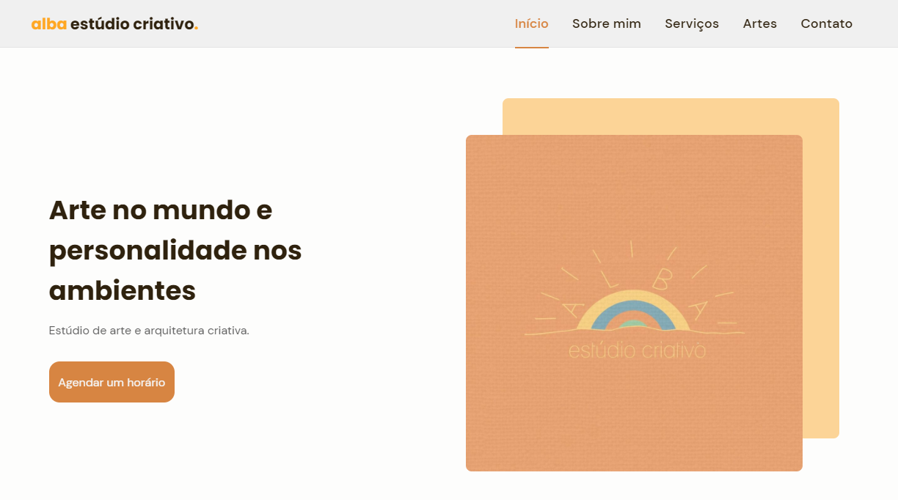

# Alba

**Site responsivo para um ateliê de arte e arquitetura, feito durante o NLW #06 da Rocketseat.**

**[Ver o site no ar](https://giobroliatto.github.io/alba-project/)**

[English](README.md) · **Português**

> [!NOTE]
> Projeto desenvolvido durante a **Next Level Week #06** da [Rocketseat](https://www.rocketseat.com.br/) (21 a 27 de julho de 2021), na trilha de HTML, CSS e JavaScript, acompanhando as aulas do [Mayk Brito](https://github.com/maykbrito).

---

## Sobre

Site do ateliê Alba ([@estudioalba](https://www.instagram.com/estudioalba/)), um estúdio criativo que oferece serviços de arte e arquitetura. A ideia era ter um jeito agradável e fácil de conhecer o ateliê, ver alguns dos trabalhos e entrar em contato.

## Destaques

- **Layout responsivo,** do celular ao desktop.
- **Conteúdo revelado conforme a rolagem** com ScrollReveal.
- **Carrossel de serviços** com Swiper.
- **Menu mobile,** cabeçalho que muda ao rolar a página e destaque no menu da seção que está na tela.
- **Transições em CSS** ao longo da página.

## Prévia

## Rodando localmente

Não tem build: basta clonar o repositório e abrir o `index.html` no navegador.

---

## Autor

Feito por **Giovani Broliatto** durante o NLW #06, com as aulas da [Rocketseat](https://www.rocketseat.com.br/).

